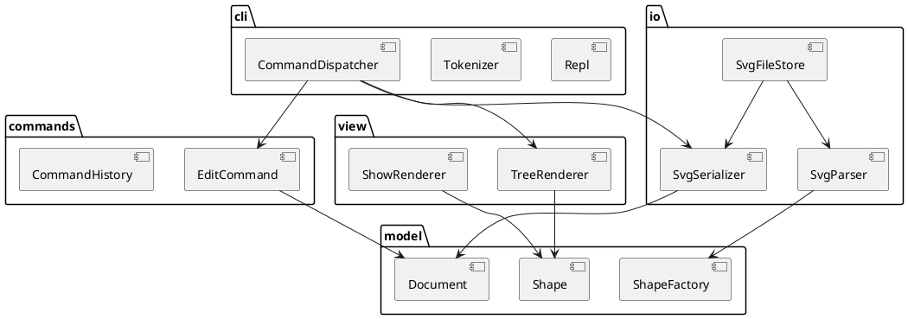

# SVG 编辑器（CLI）— 设计文档

## 运行与手动验收

建议使用 Node.js 24（现有 Vitest 5 支持的版本），在项目根目录执行：

```sh
npm ci
npm run cli
```

交互终端显示 `svg> `；输入 `help` 查看所有命令。Ctrl-D 或 Ctrl-C 退出。也可回放示例：

```sh
npm run cli < examples/flowchart.commands
```

示例在当前目录生成 `flowchart.svg`，可用浏览器手动打开。核对两个节点及中文标签，并确认第二个节点已下移 100 px、标签变为“处理数据 v2”。这是人工检查步骤，尚未代替用户完成浏览器视觉验收。

双引号包住含空格的内容或路径；引号内支持 `\\` 和 `\"` 转义，其余反斜线原样保留。只将整行开头的 `#` 视为注释，颜色值 `#ffffff` 可直接输入。管道输入不显示提示符，命令严格按顺序完成后再读下一条。空白行和注释不产生输出；一条命令失败后会显示 `error:` 并继续。

`init` 默认 800×600，只给宽度时高度仍为 600；`canvas` 无参数显示尺寸，修改时必须同时给宽高。成功 read/init 会替换文档并清空历史；成功 save 或修改 canvas 会锁定 undo/redo，直到下一次编辑。显示操作和失败命令不改变历史。

## 1. 架构方案

### 1.1 模块划分

| 模块 | 目录 | 职责 |
|---|---|---|
| 领域模型 | `src/model/` | 图形类层次（叶子图形 + 容器 `g`）、`Document`（画布尺寸、图形树、id 遍历查找）、图形工厂。纯逻辑，**不做任何 IO** |
| 编辑命令 | `src/commands/` | 每条可撤销的编辑操作是一个 Command 对象；`CommandHistory` 管理 undo/redo 栈与"IO 后禁止 undo"规则 |
| 序列化 | `src/io/` | `Document` ↔ SVG 文本的转换；文件读写；读入时自动补 id 并产生警告 |
| 视图 | `src/view/` | `tree` / `show` 的文本渲染（只读访问 model） |
| 命令行 | `src/cli/` | 分词（含双引号参数）、命令名 → 处理器的分发、REPL 循环、`error:` 输出格式 |
| 组装 | `src/main.ts` | 唯一的组装点（composition root）：创建各模块对象并接线 |



### 1.2 设计模式的选择

| 模式 | 解决的问题 | 落地位置 |
|---|---|---|
| **Command** | 编辑操作需要 undo/redo，且"一条命令 = 一个撤销单元" | `commands/`：每个编辑命令实现 `execute()` / `undo()`，`CommandHistory` 维护两个栈 |
| **Composite** | `move` / `scale` / `set` / `delete` 对 `<g>` 与叶子一视同仁 | `model/`：`Shape` 抽象基类，`Group` 持有子 `Shape` 并把操作递归转发 |
| **Factory（注册表）** | 类型名 → 图形类（`create rect …`、读入 `<rect>`） | `model/ShapeFactory`。⚠️ 按名字分派之一，**待重构**为插件注册（ShapeProvider） |
| 命令注册表 | 命令名 → 实现 | `cli/CommandDispatcher`。⚠️ 按名字分派之二，**待重构** |

> 本节随实现推进补充细节（见第 2 节修订记录）。

### 1.3 依赖方向规则

```
cli ──► commands ──► model
cli ──► io ────────► model
cli ──► view ──────► model
```

- `model` **不依赖任何模块**：它最稳定，换掉任何外壳（CLI → Web）都不应波及它。`model` 中出现 `node:fs`、`console`、或对其它模块的 import 即为违规。
- `commands` 只依赖 `model`：命令不知道自己由谁触发（CLI / Web / agent）。
- `io`、`view` 只依赖 `model`：它们是领域对象与文本之间的翻译层，彼此互不依赖。
- `cli` 处于最外层，可依赖以上所有模块；**任何模块都不得依赖 `cli`**。
- 理由：依赖只能从易变一侧指向稳定一侧。

### 1.4 变化点假设

| 变化点 | 可能性 | 预留措施 / 不预留的理由 |
|---|---|---|
| 新的输入通道（Web 鼠标、AI agent） | 高（需求已明示三种通道） | 编辑语义全部在 `commands` + `model`，外壳只负责把输入翻译成 Command |
| 新图形类型（如 `box` 插件） | 高（4.4 已定义） | 本阶段工厂用注册表实现，新增类型只需注册；完整 ShapeProvider 插槽**本阶段不做**，避免过度设计 |
| 新的编辑命令 | 中 | 命令是独立类，新增命令不改已有命令；分发表需加一行（已标注待重构） |
| 输出格式（如导出 PNG / JSON） | 低 | 序列化集中在 `io/`，model 不感知格式；不额外抽象出格式接口 |

## 2. 过程记录

### 第 5 步：图形工厂

`ShapeFactory.create(type, id, params)` 使用内置类型表创建六种图形。表中只保存构造器、必填属性顺序和可选颜色属性；数值校验复用图形的 `setAttribute`，避免另写一套几何解析规则。未知类型使用需求规定的错误文案，参数缺失或多余均拒绝。

工厂只返回未加入文档的对象。CLI 后续负责分词和剥离 `in` 子句；`CreateCommand` 负责文档内 id 唯一性检查与插入，历史栈负责撤销重做。创建失败不会向文档插入部分初始化的图形。完整插件注册接口留到后续阶段。

第 6 步已新增 `fromAttributes` 属性式入口，SVG 读入与 CLI 创建共用同一类型表。

### 第 6 步：SVG 与文本视图

`SvgParser` 使用 [saxes](https://github.com/lddubeau/saxes) 处理 XML 语法、实体、命名空间和结构错误。该依赖版本锁定为 6.0.0（上游已归档）；本项目不加载 DTD 或外部实体。解析先构造临时 XML 树并收集所有显式 id，再生成缺失 id，最后构造独立 Document。重复 id 或非法输入导致整次解析失败，调用方仅在成功后切换工作区。

`SvgSerializer` 递归访问属性、子节点和 `textContent`，负责 XML 转义。`SvgFileStore` 负责文件系统，成功读写后才更新路径；保存使用同目录临时文件和 rename，失败时清理临时文件。历史栈与 IO 相互独立，后续 CLI 在成功保存后锁定历史，在成功读入后调用 Workspace.open。

`TreeRenderer` 和 `ShowRenderer` 只读模型。这里选择多态方法而未引入 Visitor：`textContent` 提供文字，`geometrySummary` 提供简短几何描述；视图负责连接线、缩进和分行。模型保留少量纯文本表示，避免在视图中按图形类型分派。如果未来需要多种输出风格，再评估 Visitor 的维护成本。

支持边界：六种内置元素、几何与外观白名单、文字、嵌套 g、缺失 id 自动补名、data-kind 容器降级。画布尺寸使用正数 px 数值（不带单位），缺省为 800×600；viewBox 仅接受与画布相同的 `0 0 width height`。本轮没有实现通用 SVG 导入：transform、CSS、字体属性、路径、非匹配 viewBox 等会报错，不会静默丢弃。作业背景中的带 transform 示例尚不支持，后续若要求导入这一示例，需要补充变换及文字尺寸的保留方案。

### 第 7 步：CLI 与脚本回放

`Tokenizer` 只负责分词并保留参数是否带引号，以区分文字中的 `"in"` 与 create 的尾部容器子句。整行注释不会误吞颜色值，未闭合引号报错。`CommandDispatcher` 使用一张命令注册表，同时管理语法、参数数量、是否要求当前文档以及处理函数；编辑处理函数创建已有 Command 并交给历史栈。

`Repl` 使用 Node readline 逐行读取，以 await 串行执行，包括异步文件操作。它统一输出错误并继续下一行，终端显示提示符，脚本输入无提示符。main.ts 负责组装。测试发现 EOF 可能先于最后一条命令完成，此时再次 prompt 会抛出 readline was closed；修正为监听 close 状态，仅在终端尚未关闭时显示下一次提示符。

### 修订记录

| 日期 | 修订内容 | 原因 |
|---|---|---|
| 2026-10-19 | 初版架构方案 | — |
| 2026-10-24 | 实现 ShapeFactory；将 id 索引描述修正为遍历查找 | 与现有模型保持一致，明确工厂与命令的责任边界 |
| 2026-10-24 | 实现 SVG IO、tree/show 与属性式工厂入口 | 复用模型多态，明确外部 SVG 支持边界 |
| 2026-10-24 | 接通 CLI、脚本回放与帮助；修复 EOF 后 prompt 错误 | 完成终端操作链路并以真实子进程验证 |

## 3. 一致性自查

截至第 7 步，model、commands、io、view、cli 均已实现，main.ts 已接通各层。新增 SvgFileStore、SvgElement、XmlEscaper 已归入 io；新增 ShowRenderer 已归入 view。架构依赖测试通过，model 不引用 IO，io/view 不引用 commands/cli。CLI 注册表是方案允许的命令名分派，图形类型分派仍集中在 ShapeFactory；最终提交前还需人工预览及交付检查。

## 4. 质量保证手段

截至第 7 步，109 个测试通过（使用 Node 24 运行 Vitest），`npm run typecheck` 通过。工厂测试覆盖六种类型、浮点与负坐标、可选颜色、含空格及空字符串的文字、未知类型、空 id、参数数量与非法数字。集成测试验证工厂产物进入容器后的撤销重做，以及创建失败不改变文档或破坏 redo 历史。

SVG 测试覆盖需求第 6 节的 other.svg、自动 id 与显式 id 冲突、六种元素往返、XML 转义与文字空白、非法 XML、重复 id、未知属性、文件保存与失败保护。视图测试核对 tree 连接线、子树、show 属性和渲染不修改模型。

CLI 测试覆盖分词、全部命令的调用、参数错误、缺少文档、IO 成败与历史状态、EOF 和终端提示符。真实 Node 子进程回放包含 save/read 的流程，验证异步顺序和落盘 SVG。类型检查及构建通过。浏览器人工预览和最终提交检查仍待完成。
