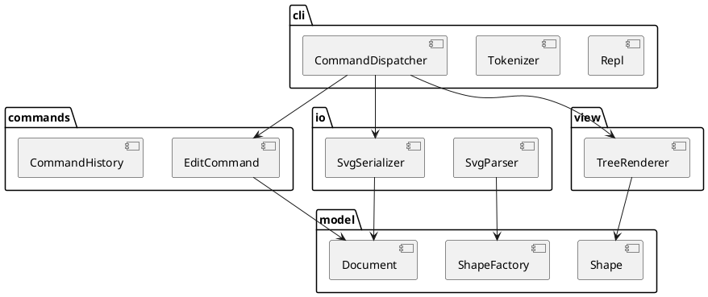

# SVG 编辑器（CLI）— 设计文档

## 1. 架构方案

### 1.1 模块划分

| 模块 | 目录 | 职责 |
|---|---|---|
| 领域模型 | `src/model/` | 图形类层次（叶子图形 + 容器 `g`）、`Document`（画布尺寸、图形树、id 遍历查找）、图形工厂。纯逻辑，**不做任何 IO** |
| 编辑命令 | `src/commands/` | 每条可撤销的编辑操作是一个 Command 对象；`CommandHistory` 管理 undo/redo 栈与"IO 后禁止 undo"规则 |
| 序列化 | `src/io/` | `Document` ↔ SVG 文本的转换；文件读写；读入时自动补 id 并产生警告 |
| 视图 | `src/view/` | `tree` / `show` 的文本渲染（只读访问 model） |
| 命令行 | `src/cli/` | 分词（含双引号参数）、命令名 → 处理器的分发、REPL 循环、`error:` 输出格式 |
| 组装 | `src/main.ts` | 唯一的组装点（composition root）：创建各模块对象并接线 |



### 1.2 设计模式的选择

| 模式 | 解决的问题 | 落地位置 |
|---|---|---|
| **Command** | 编辑操作需要 undo/redo，且"一条命令 = 一个撤销单元" | `commands/`：每个编辑命令实现 `execute()` / `undo()`，`CommandHistory` 维护两个栈 |
| **Composite** | `move` / `scale` / `set` / `delete` 对 `<g>` 与叶子一视同仁 | `model/`：`Shape` 抽象基类，`Group` 持有子 `Shape` 并把操作递归转发 |
| **Factory（注册表）** | 类型名 → 图形类（`create rect …`、读入 `<rect>`） | `model/ShapeFactory`。⚠️ 按名字分派之一，**待重构**为插件注册（ShapeProvider） |
| 命令注册表 | 命令名 → 实现 | `cli/CommandDispatcher`。⚠️ 按名字分派之二，**待重构** |

> 本节随实现推进补充细节（见第 2 节修订记录）。

### 1.3 依赖方向规则

```
cli ──► commands ──► model
cli ──► io ────────► model
cli ──► view ──────► model
```

- `model` **不依赖任何模块**：它最稳定，换掉任何外壳（CLI → Web）都不应波及它。`model` 中出现 `node:fs`、`console`、或对其它模块的 import 即为违规。
- `commands` 只依赖 `model`：命令不知道自己由谁触发（CLI / Web / agent）。
- `io`、`view` 只依赖 `model`：它们是领域对象与文本之间的翻译层，彼此互不依赖。
- `cli` 处于最外层，可依赖以上所有模块；**任何模块都不得依赖 `cli`**。
- 理由：依赖只能从易变一侧指向稳定一侧。

### 1.4 变化点假设

| 变化点 | 可能性 | 预留措施 / 不预留的理由 |
|---|---|---|
| 新的输入通道（Web 鼠标、AI agent） | 高（需求已明示三种通道） | 编辑语义全部在 `commands` + `model`，外壳只负责把输入翻译成 Command |
| 新图形类型（如 `box` 插件） | 高（4.4 已定义） | 本阶段工厂用注册表实现，新增类型只需注册；完整 ShapeProvider 插槽**本阶段不做**，避免过度设计 |
| 新的编辑命令 | 中 | 命令是独立类，新增命令不改已有命令；分发表需加一行（已标注待重构） |
| 输出格式（如导出 PNG / JSON） | 低 | 序列化集中在 `io/`，model 不感知格式；不额外抽象出格式接口 |

## 2. 过程记录

### 第 5 步：图形工厂

`ShapeFactory.create(type, id, params)` 使用内置类型表创建六种图形。表中只保存构造器、必填属性顺序和可选颜色属性；数值校验复用图形的 `setAttribute`，避免另写一套几何解析规则。未知类型使用需求规定的错误文案，参数缺失或多余均拒绝。

工厂只返回未加入文档的对象。CLI 后续负责分词和剥离 `in` 子句；`CreateCommand` 负责文档内 id 唯一性检查与插入，历史栈负责撤销重做。创建失败不会向文档插入部分初始化的图形。完整插件注册接口留到后续阶段。

SVG 读入尚未实现；当前工厂接收位置参数，后续读入模块需要将 XML 属性适配到创建入口，或在工厂内增加属性式入口，并复用同一类型表。

### 修订记录

| 日期 | 修订内容 | 原因 |
|---|---|---|
| 2026-10-19 | 初版架构方案 | — |
| 2026-10-24 | 实现 ShapeFactory；将 id 索引描述修正为遍历查找 | 与现有模型保持一致，明确工厂与命令的责任边界 |

## 3. 一致性自查

_（实现完成后填写）_

## 4. 质量保证手段

截至第 5 步，`npm test` 的 64 个测试通过，`npm run typecheck` 通过。工厂测试覆盖六种类型、浮点与负坐标、可选颜色、含空格及空字符串的文字、未知类型、空 id、参数数量与非法数字。集成测试验证工厂产物进入容器后的撤销重做，以及创建失败不改变文档或破坏 redo 历史。

这些检查覆盖已实现的模型、命令与工厂；SVG 读写、显示和 CLI 尚未实现，最终功能完整性仍需后续验收。
